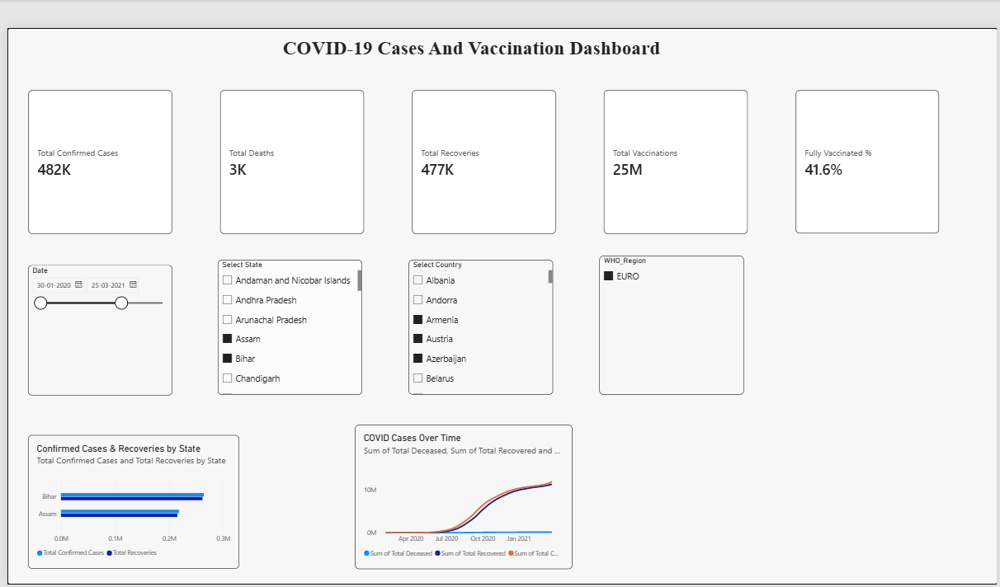
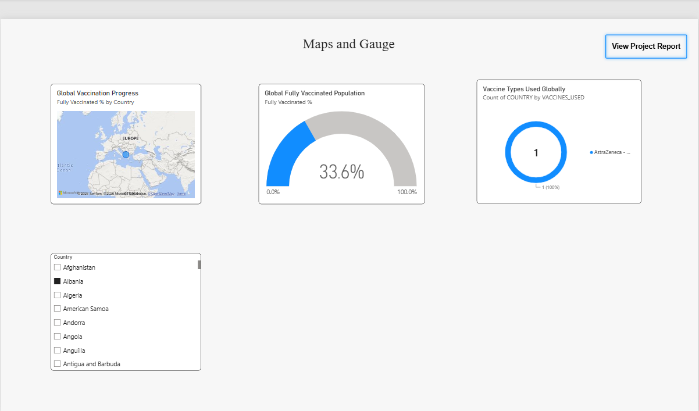

# 📊 COVID-19 Vaccination Analysis Dashboard

An interactive **Power BI dashboard** designed to explore COVID-19 vaccination trends, compare vaccination progress across countries, and present meaningful insights through data visualization.

## 📌 Project Overview

This project focuses on analyzing COVID-19 vaccination data to understand global vaccination progress and identify patterns across different countries.

Using Power BI, I transformed raw datasets into interactive visualizations and KPIs to make the information easier to understand and explore.

## 🖥️ Dashboard Preview





## 🎯 Project Objectives

- Analyze COVID-19 vaccination progress across countries.
- Compare vaccination coverage between different regions.
- Track key vaccination indicators using KPIs.
- Identify trends and patterns through interactive visualizations.
- Present data in a clear and understandable format.

## 🛠️ Tools & Technologies

| Tool | Purpose |
|---|---|
| Power BI | Dashboard development and visualization |
| Power Query | Data cleaning and transformation |
| DAX | Measures and KPI calculations |
| Excel / CSV | Dataset handling |

## 📈 Key Dashboard Features

- **KPI Cards:** Display important vaccination indicators.
- **Country Comparison:** Compare vaccination progress across countries.
- **Trend Analysis:** Explore changes in vaccination over time.
- **Geographical Map:** Visualize vaccination distribution across locations.
- **Interactive Visuals:** Explore data using filters and visual interactions.

## 🔍 Key Learnings

- Data cleaning and transformation using Power Query.
- Creating calculated measures using DAX.
- Designing interactive dashboards.
- Working with geographical and time-based visualizations.
- Converting raw data into meaningful insights.

## 📁 Project Structure

```text
COVID-19-Vaccination-Analysis/
│
├── Dashboard/
│   └── COVID_Vaccination_Dashboard.pbix
│
├── Dataset/
│   └── Source datasets
│
├── Images/
│   └── dashboard-screenshot.png
│
└── README.md
```

## 🚀 How to Explore the Project

1. Clone or download this repository.
2. Open the `.pbix` file using Microsoft Power BI Desktop.
3. Explore the dashboard and interact with the visualizations.

## 👨‍💻 Author

**Utsav Soni**

MCA Graduate | Aspiring Data Analyst

Interested in transforming data into meaningful insights using Python, SQL, Excel, and Power BI.

[LinkedIn](YOUR_LINKEDIN_URL) | [GitHub](YOUR_GITHUB_URL)

---

⭐ If you find this project interesting, feel free to explore the repository!
